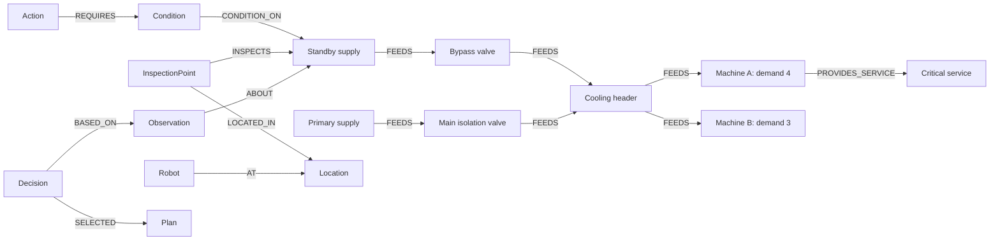

# Ripple

**An evidence-driven robot demo for preventing cascading equipment failures.**

Ripple uses **FalkorDB as its primary database** to connect infrastructure dependencies, inspection evidence, action prerequisites and decision records. A robot investigates missing facts before the planner selects an intervention. **Cyberwave** provides an optional Go2 digital twin with independently checked position updates.

The demonstration models a shared cooling system: a critical machine needs 4 units and a lower-priority machine needs 3. When the primary supply fails, a 5-unit standby cannot support both. Ripple discovers its capacity through inspection, stops the lower-priority machine, restores supply and verifies observed flow against remaining demand.

> All equipment behavior and sensor values are synthetic. Cyberwave movement is twin repositioning, not walking. Graph copies evaluate modeled state changes, not hydraulic physics.

## Submission links

- Source repository: [siddharth270/RippleFalkorDB](https://github.com/siddharth270/RippleFalkorDB)
- [Complete local setup and troubleshooting](docs/local-setup.md)
- [Implemented graph data model](docs/graph-model.md)
- [Cypher query catalog and graph algorithms](docs/queries.md)
- [Demo script and simulation boundaries](docs/demo-script.md)
- [Submission guide](docs/submission.md)

**Delivery mode:** complete local setup. The localhost URLs below are not public deployment URLs. Judges can run the full deterministic demo without a Cyberwave or LLM key; Cyberwave is an optional external integration.

## Quick start

Prerequisites: Git, Docker with Compose v2, Python 3.12 managed by [uv](https://docs.astral.sh/uv/), and Node.js 22 LTS with npm. Commands below use a POSIX shell (macOS, Linux or Windows WSL2). Docker must be running.

```bash
git clone https://github.com/siddharth270/RippleFalkorDB.git
cd RippleFalkorDB
docker compose up -d falkordb
```

Start the backend in this terminal:

```bash
cd backend
uv sync --locked --python 3.12
uv run uvicorn ripple.api.main:app --host 127.0.0.1 --port 8000
```

In a second terminal, from the repository root:

```bash
cd frontend
npm ci
npm run dev -- --host 127.0.0.1
```

Open **http://127.0.0.1:5173**. Confirm **FalkorDB connected**, then select:

- Fault scenario: **Limited standby · 5 units**
- Robot: **Local simulated inspector**
- Policy: **Full Ripple**

Click **Inject fault & run**. Expected: **Reduce Load Then Restore**, **Verified**, flow/demand **5 / 4**, **7 inspections**, **0 verification failures**. Each run seeds its own graph automatically; there is no separate manual seed step. Use **Dependencies**, expand rejected-plan explanations, replay event snapshots, and export the trace.

No `.env` or API key is required for this default local run. If ports are occupied, see [local setup](docs/local-setup.md).

## Why the graph is essential

The runtime reads topology, available actions, prerequisites, evidence, robot locations and inspection points from FalkorDB through named Cypher queries. Removing it prevents the decision loop from running.

1. Multi-hop `FEEDS` traversals find upstream supplies, downstream machines and critical services.
2. Timestamped `Observation` nodes supply current evidence; freshness is checked in application logic.
3. Missing action prerequisites identify useful inspections; `algo.SPpaths` finds the cheapest graph route.
4. A bounded cooling-domain planner constructs short candidates from graph actions and supply paths.
5. Each candidate is evaluated in a real `GRAPH.COPY` branch. Predicted observations remain branch-local; branches are deleted after evaluation.
6. A persisted `Decision` records the revision, available evidence context, alternatives, selection and rejection reasons. Explanations are read back from this record.
7. `ExecutionAttempt` records are linked to fresh verification observations. A command acknowledgement is not evidence of a successful effect.

Capacity calculations, freshness windows, inspection scoring and transition effects are our application logic over graph results. The planner is deterministic and domain-specific, not a general-purpose or learned planner.

## Graph data model



Assets hold static facts such as demand and nominal capacity. Changing equipment state is represented by observations with values, timestamps and sources. Physical connectivity (`CONNECTED_TO`) is separate from operational flow (`FEEDS`). Robot position is an `AT` edge updated only after verified arrival. Plans store ordered action IDs; decisions store the revision number as a property. See the [full implemented schema](docs/graph-model.md) for properties, relationships, indexes and known limits.

## Reproducible scenarios

- `healthy_8`: direct standby restoration; flow **8**, demand **7**, recovered.
- `healthy_5`: shed Machine B, then restore; flow **5**, demand **4**, recovered.
- `standby_down`: degraded shedding only; **not recovered**.
- `stale_valve`: stale evidence is not trusted as current state; restoration verified.
- `stuck_valve`: command acknowledged, valve unchanged; **one verification failure**, **not recovered**.
- `new_load`: YAML adds critical Machine C, demand 2. The same planner now sheds B before restoration; flow **8**, remaining demand **6**.

The API also exposes **Graph / no diagnosis inspection** and **Local reactive baseline** policies. These are intentionally limited diagnostic comparisons, not optimized competitors.

## Tests and evaluation

With FalkorDB running, from `backend/`:

```bash
uv run pytest -q
uv run python -m scripts.evaluate
uv run python -m scripts.run_demo healthy_5 --adapter mock --output ../eval/results/demo.json
```

The evaluator runs 3 policies × 6 scenarios and writes `eval/results/evaluation.json`. Generated results are gitignored; regenerate them locally. Evaluation graphs are deleted by the evaluator. Demo graphs remain available for inspection.

From `frontend/`, validate the production build with `npm run build`. The application is served through Vite in this local demonstration; a frontend bundle alone does not include the backend or database.

## Optional Cyberwave integration

From the repository root, copy the template only if you do not already have a configured file:

```bash
test -f backend/.env || cp .env.example backend/.env
```

Put your own `CYBERWAVE_API_KEY` in `backend/.env` (gitignored). Never commit it. Create or select an environment in your own Cyberwave workspace, then run from `backend/`:

```bash
uv run python -m scripts.setup_cyberwave --environment YOUR_WORKSPACE_SLUG/envs/YOUR_ENVIRONMENT_SLUG
```

Replace the example slug with your environment's actual slug. The script reuses or creates the named Ripple twin and equipment markers, then writes the environment, workspace and twin IDs into `.env`. Restart the backend, select **Cyberwave Go2 twin**, and open your environment while signed in. This route does not start a cloud physics instance. The dashboard's Open Cyberwave link currently points to the team's demonstration environment; judges using another workspace should open their own environment URL directly.

For a trace-only run, from `backend/`:

```bash
uv run python -m scripts.run_demo healthy_5 --adapter cyberwave --output ../eval/results/cyberwave-demo.json
```

Use the setup and demo scripts above. Older `cyberwave_proof.py` and `cyberwave_reposition_proof.py` are historical experiments with collaborator-specific IDs; the former may start billable simulation and is not required.

## Architecture and limits

Backend: Python/FastAPI, deterministic planner, facility simulator, robot adapters and FalkorDB repository. Frontend: React/TypeScript/Vite with WebSocket event streaming. See [architecture](docs/architecture.md) and [design decisions](docs/decisions.md).

This is a local, single-process demonstration. It accepts one API run at a time, keeps its run index in memory and retains demonstration graphs for inspection. It has no public-deployment authentication or atomic multi-operator actuation lock. Do not expose it as an unrestricted control service.

Not implemented: LLM/MCP orchestration, physical locomotion/manipulation, camera-derived evidence, automatic replanning after failed verification, or dynamic temperature/fluid simulation. Logical event times and graph travel costs are not physical outage-duration measurements. The static Cyberwave marker scene represents the base facility; the new-load scenario is reflected in the dashboard graph.

## AI assistance disclosure

Built with Claude Code (Anthropic) and Codex (OpenAI) as coding assistants. Decisions and simulation boundaries are documented in this repository. The demo does not use an LLM at runtime.
