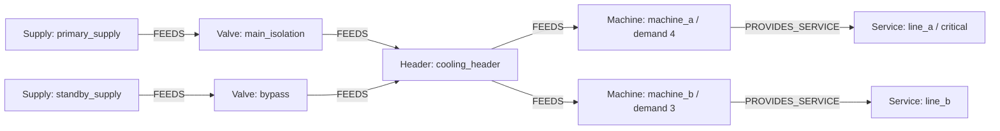
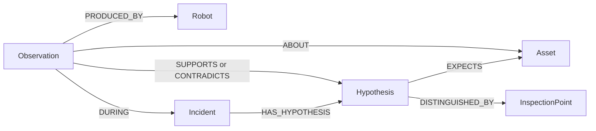
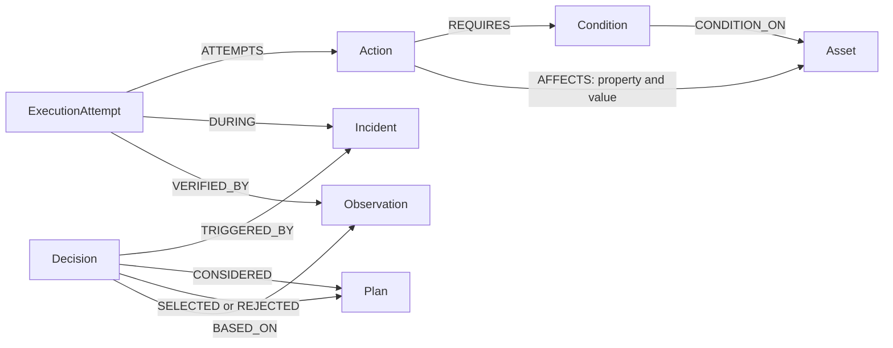

# Implemented graph data model

This document describes the running simulation, not every extension proposed in the original concept. Node and edge creation is defined by [scenario seeding](../backend/ripple/graph/seed.py) and [named runtime queries](../backend/ripple/graph/queries/). All facility values are synthetic.

## Facility dependencies

`Asset` is a shared label on `Supply`, `Valve`, `Header` and `Machine`. Static properties include `id`, `name`, `nominal_capacity` for supplies, `normally` for valves, and `demand`/`criticality` for machines. A supply's observed usable capacity can differ from its nominal design capacity.

`FEEDS` is directed operational reachability. `CONNECTED_TO` represents physical connectivity and is queried with undirected meaning. A flow path does not prove adequate capacity: [capacity.py](../backend/ripple/planning/capacity.py) combines topology with usable observations and active machine demand.

A `Service` has `id`, `name`, and boolean `critical`. `PROVIDES_SERVICE` connects machines to services. The `new_load` scenario adds Machine C (demand 2), its service and relationships through YAML without changing planner code.

## Location and inspection

- `Location {id, name, x, y}` nodes connect through `ADJACENT_TO {cost}`. Costs are synthetic route weights, not measured physical travel times.
- `Robot {id, name}` has one `AT {since}` relationship to its verified location.
- `Asset`, `InspectionPoint` and `Sensor` nodes use `LOCATED_IN` to connect to locations.
- `InspectionPoint {id, name}` connects to assets through `INSPECTS {property}`. An inspection point is not an asset.
- `Sensor {id, kind}` uses `MEASURES {property}` for coverage.

The routing query uses `algo.SPpaths` over `ADJACENT_TO` with `weightProp: 'cost'`, `relDirection: 'both'` and `pathCount: 1`. The adapter must confirm arrival before the `AT` relationship moves. Sensing requires the robot and inspection point to share a location.

## Evidence and hypotheses

An `Observation` stores `id`, `property`, `value`, optional `unit`, `observed_at`, `ingested_at`, `quality`, `source` and optional `mission_id`. Sources are `robot`, `sensor`, `log`, or branch-local `predicted`. `ABOUT` identifies the asset, `PRODUCED_BY` identifies a known producer, and `DURING` links incident observations.

Dynamic equipment state is evidence rather than a mutable status property on the asset. Observations are appended; the latest observation for an asset/property is selected and checked against that property's freshness window. A stale latest observation is not made valid by falling back to an older one. See [beliefs](../backend/ripple/evidence/beliefs.py) and [freshness windows](../backend/ripple/evidence/freshness.py).

`Incident {id, opened_at, status}` has `CONCERNS` to the triggering asset. Scenario `HypothesisTemplate` nodes have `EXPECTS {property, op, value}` and `DISTINGUISHED_BY` edges. These are instantiated as incident-specific `Hypothesis {id, template, name, status}` nodes. `SUPPORTS` and `CONTRADICTS` store the applied rule; they express evidence, not proof of causation or calibrated probabilities.

Demo events use a synthetic logical clock. Timestamps are comparable within the run but must not be presented as measured physical outage durations.

## Actions, decisions and verification

- `Action {id, name, kind}` declares effects through `AFFECTS {property, value}`.
- `Condition` has `id`, `property`, `op`, `value`, `kind`, and optionally `check`. Evidence conditions require usable observations; computed conditions such as demand-within-capacity call application checks. All required conditions must pass.
- `Plan {id, name, actions}` stores the **ordered array of action IDs** used in this implementation.
- `Decision {id, made_at, summary, revision}` records the graph revision as a **number property**. It has `TRIGGERED_BY`, `CONSIDERED`, `SELECTED`, `REJECTED {reason}` and `BASED_ON` relationships.
- `StateRevision {id: 'current', n, at}` is a singleton updated on observation insert. The revision is not an immutable historical graph snapshot or an atomic physical-actuation lock.
- `ExecutionAttempt` includes `id`, `asset_id`, `property`, `expected`, `sent_at`, `ack_at`, and `status`. Runtime states distinguish sent/acknowledged/rejected from verified/failed effects. `VERIFIED_BY` points to the checking observation.

The decision records the available non-predicted evidence context at selection time. This is not a minimal proof graph identifying only the observations used by each condition. Execution attempts link to the incident and action; the current implementation does not persist `PlanStep`, `HAS_STEP`, `NEXT`, `EXECUTES`, `RESULTED_IN` or `AT_REVISION` relationships proposed in earlier drafts.

## Counterfactual graph branches

[branching.py](../backend/ripple/graph/branching.py) calls the real FalkorDB `GRAPH.COPY` mechanism through the SDK. [evaluator.py](../backend/ripple/planning/evaluator.py) checks action prerequisites and inserts declared effects as observations with `source='predicted'` in that copy. Missing evidence remains unresolved; projections cannot make an undecided plan executable. Branches are deleted in a `finally` block, including on evaluation errors.

The live graph receives actual simulator/robot observations and execution records, not hypothetical effect writes. A graph copy supplies state isolation; the transition model and capacity checks supply domain semantics.

## Indexes actually created

[schema.py](../backend/ripple/graph/schema.py) creates range indexes on `id` for Asset, Location, InspectionPoint, Action, Condition, Robot, Observation, Incident and ExecutionAttempt, and on `Observation.property`. Creation is idempotent. Indexes for Decision or Hypothesis are not currently created.

## Design choices and limits

The accepted DP1–DP5 choices remain: observations hold changing state; physical and operational connections are separate; inspection points have their own label; robot location updates follow verified arrival; predicted observations stay in branches. See [decisions](decisions.md).

Capacity, freshness and ranking are application rules over graph data. Short candidate sequences are bounded to this cooling domain. There is one robot and no learned perception, probabilistic causal model, full fluid/thermal simulation, or automatic replanning after verification failure.
